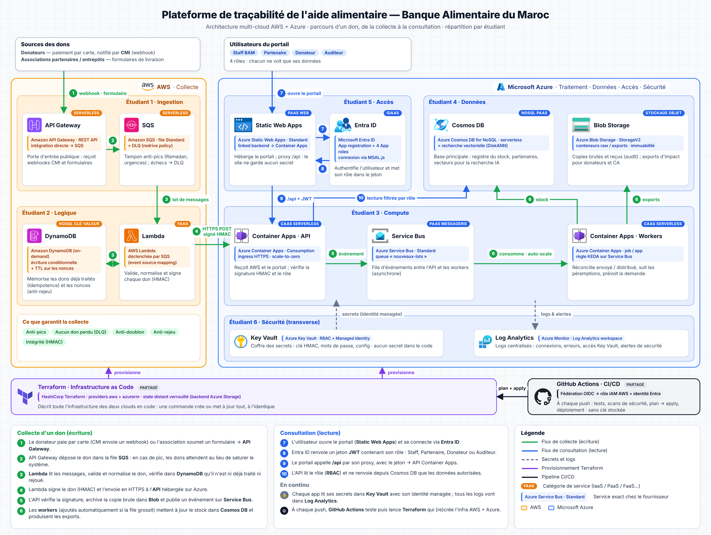

# Plateforme de traçabilité de l'aide alimentaire — Banque Alimentaire du Maroc

Projet Cloud Computing (ESI · 3A) — architecture **multi-cloud AWS + Azure**.
Un don entre par **AWS** (collecte publique), il est traité, stocké et consulté sur **Azure** (données privées + accès).



> Version détaillée (décisions d'architecture, pipeline DevOps) : [`docs/architecture-detaillee.pdf`](docs/architecture-detaillee.pdf)

---

## Équipe et répartition

| Rôle | Dossier(s) | Services | Membre |
|---|---|---|---|
| Étudiant 1 · Ingestion | `aws/ingest/`, `infra/aws/modules/ingest/` | API Gateway, SQS + DLQ | _à compléter_ |
| Étudiant 2 · Validation des lots | `aws/logic/`, `infra/aws/modules/logic/` | Lambda, DynamoDB | _à compléter_ |
| Étudiant 3 · Calcul | `azure/api/`, `azure/workers/`, `infra/azure/modules/compute/` | Container Apps, Service Bus | _à compléter_ |
| Étudiant 4 · Données | `azure/data/`, `infra/azure/modules/data/` | Cosmos DB, Blob Storage | _à compléter_ |
| Étudiant 5 · Accès | `azure/portal/`, `infra/azure/modules/access/` | Static Web Apps, Entra ID | _à compléter_ |
| Étudiant 6 · Sécurité | `azure/security/`, `infra/azure/modules/security/` | Key Vault, Log Analytics | _à compléter_ |
| Partagé · DevOps | `infra/`, `.github/`, `local/` | Terraform, GitHub Actions | toute l'équipe |

Le dossier **`contracts/`** appartient à **toute l'équipe** : c'est l'accord commun qui permet à chacun de travailler en parallèle.

---

## Démarrage rapide (local, 0 DH)

Prérequis : **Git**, **Docker Desktop**, **Python 3.12**, **Node.js 22**.

```bash
git clone https://github.com/<organisation>/food-aid-platform.git
cd food-aid-platform
cp local/.env.example local/.env          # mot de passe local de l'émulateur SQL (jamais commité)
docker compose -f local/docker-compose.yml up -d --build
```

Cela lance **toute la plateforme sur votre PC** avec des émulateurs officiels :

| Service cloud | Émulateur local | Port |
|---|---|---|
| SQS | ElasticMQ | 9324 (console : 9325) |
| DynamoDB | DynamoDB Local | 8001 |
| Lambda | `lambda-runner` (lit la file et appelle le handler) | — |
| Container Apps · api | conteneur `api` (FastAPI) | 8080 |
| Container Apps · workers | conteneur `workers` | — |
| Service Bus | Émulateur Service Bus | 5672 |
| Cosmos DB | Émulateur Linux Cosmos DB | 8081 (explorateur : 1234) |
| Blob Storage | Azurite | 10000 |

Envoyer un don de test de bout en bout :

```bash
pip install boto3
python aws/ingest/send_test_donation.py --local
# puis consulter les données (rôle simulé en local) :
curl -H "X-Dev-Role: Staff" http://localhost:8080/query
```

Portail (Étudiant 5) : voir [`azure/portal/README.md`](azure/portal/README.md).

---

## Règles de travail

1. **On ne pousse jamais directement sur `main`** : une branche par tâche, puis une Pull Request (voir [`CONTRIBUTING.md`](CONTRIBUTING.md)).
2. **On code contre `contracts/`**, pas contre le code des autres. Un changement de contrat = une PR revue par toute l'équipe.
3. **Aucun secret dans le dépôt** (`.env`, clés, mots de passe) : le dépôt est public.
4. **Le cloud coûte de l'argent** : on développe en local, on déploie seulement pendant les sessions d'intégration, puis on détruit (voir [`docs/couts.md`](docs/couts.md)).
5. **Personne ne lance `terraform apply` depuis son PC** : seul le pipeline GitHub Actions déploie.

---

## Documentation

| Fichier | Contenu |
|---|---|
| [`docs/mise-en-place-github.md`](docs/mise-en-place-github.md) | Créer l'organisation, inviter l'équipe, protéger `main` (à faire une seule fois) |
| [`docs/mise-en-place-cloud.md`](docs/mise-en-place-cloud.md) | Abonnement Azure, compte AWS, accès de chaque membre, OIDC |
| [`docs/couts.md`](docs/couts.md) | Choix des SKU, budgets, règles « créer puis détruire » |
| [`contracts/`](contracts/) | Formats d'échange entre les services |
